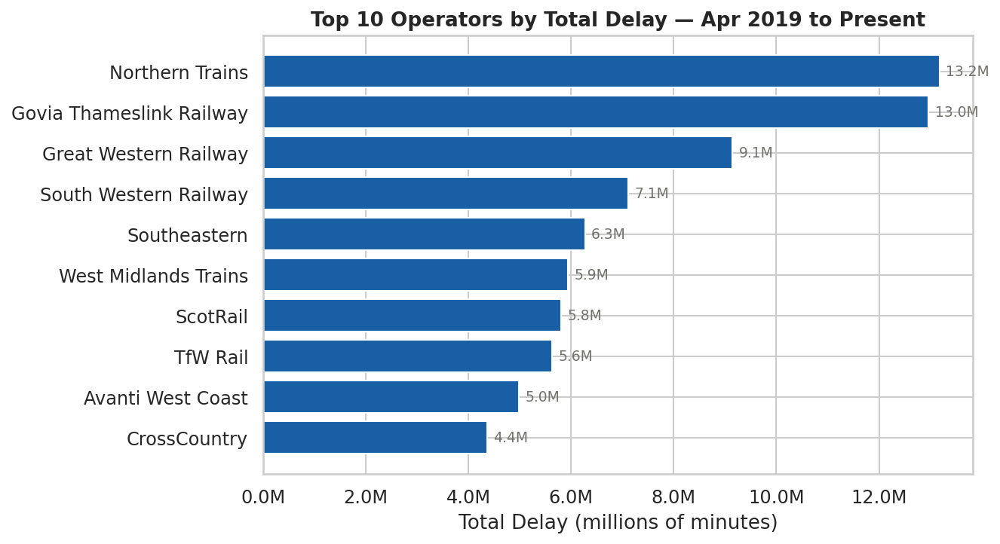

# 🚂 UK Train Delay Analytics

> **Production-style data pipeline** — Official ORR data · AWS S3 · AWS Lambda · Python · Machine Learning · Streamlit Dashboard

[](https://python.org)
[](https://aws.amazon.com/s3/)
[](https://aws.amazon.com/lambda/)
[](https://streamlit.io)
[](https://dataportal.orr.gov.uk)
[](LICENSE)

---

## 📌 Project Overview

End-to-end data engineering pipeline that ingests **official UK rail performance data** from the Office of Rail and Road (ORR), processes it automatically via **AWS Lambda**, stores it in **Amazon S3**, and serves it through an interactive **Streamlit dashboard** with a built-in **Machine Learning** predictor.

### Key questions answered
- Which operators accumulate the most delay minutes — and why?
- How did COVID-19 impact UK rail punctuality?
- Are delays caused by Network Rail or Train Operating Companies?
- Which UK stations have the worst punctuality and cancellation rates?
- Can ML predict whether an operator will underperform next quarter?

---

## 🏗 Architecture (V1)

```
 ORR Data Portal
       │
       ▼ manual download (future: automated scraper)
 ┌─────────────────────────────────────────────────┐
 │              Amazon S3                          │
 │  s3://uk-train-delay-abu/                       │
 │    ├── raw/        ← ORR Excel/ODS files        │
 │    ├── processed/  ← cleaned CSVs               │
 │    └── models/     ← trained ML model           │
 └──────────────┬──────────────────────────────────┘
                │ S3 PutObject trigger
                ▼
 ┌──────────────────────────────┐
 │       AWS Lambda             │
 │  uk-train-delay-pipeline     │
 │  • Detects which table       │
 │  • Runs cleaner in-memory    │
 │  • Writes CSV → processed/   │
 │  • Logs to CloudWatch        │
 └──────────────────────────────┘
                │
                ▼
 ┌──────────────────────────────┐
 │     Local SQLite / RDS*      │  ← *RDS in V2
 │     delays.db                │
 └──────────────────────────────┘
                │
                ▼
 ┌──────────────────────────────┐
 │    Streamlit Dashboard       │
 │    6 interactive pages       │
 │    Live ML predictor         │
 └──────────────────────────────┘
```

### Roadmap
| Version | Status | Stack addition |
|---------|--------|---------------|
| **V1** | ✅ Live | AWS S3 + Lambda auto-pipeline |
| V2 | 🔜 Next | Amazon RDS PostgreSQL |
| V3 | 🔜 Planned | Docker + AWS ECS (always-live dashboard) |
| V4 | 🔜 Planned | AWS Glue + Athena (serverless data lake) |

---

## 📊 Data Sources

Free official data from [dataportal.orr.gov.uk](https://dataportal.orr.gov.uk):

| Table | Description | Rows |
|-------|-------------|------|
| **3184** | Delay minutes by operator and cause (periodic) | 2,140 |
| **3133** | Quarterly punctuality by operator (2014–2025) | 1,095 |
| **3130** | Time-to-3 and cancellations by station | 101,205 |

---

## 🛠 Tech Stack

| Layer | Technology |
|-------|-----------|
| Cloud storage | **Amazon S3** |
| Serverless compute | **AWS Lambda** (auto-triggered on upload) |
| Monitoring | **AWS CloudWatch** |
| Data cleaning | Python · pandas · openpyxl · odfpy |
| Database | SQLite (V1) → Amazon RDS (V2) |
| Analysis | pandas · matplotlib · seaborn |
| Machine Learning | scikit-learn · Random Forest · joblib |
| Dashboard | Streamlit · Plotly |

---

## 🗂 Project Structure

```
uk-train-delay-analytics/
├── config.py                   ← Central config (bucket name, paths)
├── scripts/
│   ├── s3_utils.py             ← S3 upload/download helpers (boto3)
│   ├── upload_to_s3.py         ← One-time S3 seeding script
│   ├── clean_data.py           ← Local cleaning pipeline
│   ├── load_to_sql.py          ← Loads CSVs → SQLite
│   ├── analysis.py             ← Generates 6 charts
│   └── ml_model.py             ← Trains Random Forest model
├── lambda/
│   ├── lambda_function.py      ← AWS Lambda handler
│   └── deploy_lambda.sh        ← One-command deploy script
├── app/
│   └── streamlit_app.py        ← Interactive dashboard (6 pages)
├── data/                       ← Raw + processed files (gitignored, stored in S3)
├── database/delays.db          ← SQLite DB (committed so the dashboard runs out of the box)
├── models/                     ← Trained Random Forest + encoder
├── visuals/                    ← 7 generated charts
├── requirements.txt
└── README.md
```

---

## 🚀 Getting Started

### Prerequisites
- Python 3.10+
- AWS account (Free Tier is sufficient)
- AWS CLI configured (`~/.aws/credentials`)

### 1. Clone & install
```bash
git clone https://github.com/AbubakarShaikh00/uk-train-delay-analytics.git
cd uk-train-delay-analytics

python -m venv .venv
.venv\Scripts\activate        # Windows
source .venv/bin/activate     # Mac/Linux

pip install -r requirements.txt
```

### 2. Configure AWS
Edit `config.py` and set your S3 bucket name, or set the environment variable:
```bash
export S3_BUCKET=your-bucket-name
```

### 3. Download ORR data
Download Tables 3184, 3133, 3130 from [dataportal.orr.gov.uk](https://dataportal.orr.gov.uk) into `data/raw/`.

### 4. Run locally
```bash
python scripts/clean_data.py    # Clean the raw files
python scripts/load_to_sql.py   # Load into SQLite
python scripts/analysis.py      # Generate charts
python scripts/ml_model.py      # Train ML model
streamlit run app/streamlit_app.py   # Launch dashboard
```

### 5. Deploy to AWS
```bash
# Seed S3 with existing files
python scripts/upload_to_s3.py

# Deploy Lambda (requires AWS CLI)
bash lambda/deploy_lambda.sh
```

After deploy, any new ORR file uploaded to `s3://your-bucket/raw/` automatically triggers the full cleaning pipeline.

---

## 📈 Results




---

## 🤖 ML Model Results

| Metric | Score |
|--------|-------|
| Accuracy | **87%** |
| ROC AUC | **0.944** |
| CV F1 (5-fold) | **0.813** |

Predicts whether an operator will fall below 80% on-time punctuality next quarter using lag features, seasonality, and delay cause ratios.

---

## 📜 License

MIT — free to use, modify, distribute.

## 🙏 Data Attribution

Data from the **Office of Rail and Road (ORR)** under the [Open Government Licence v3.0](https://www.nationalarchives.gov.uk/doc/open-government-licence/version/3/).
